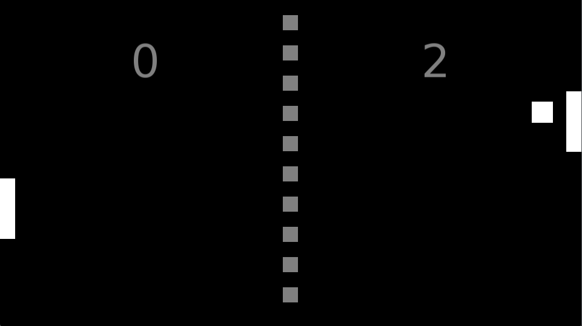

# Pong SFML
Primitive Pong clone made with SFML. My first SFML project.


## Building
This project depends on C++17 and [SFML](https://www.sfml-dev.org/). The recommended way to build it is using CMake:
```bash
cmake -B build
cmake --build build
```
The executable will be located in `build/pong`. The assets folder must be in the same folder in which the executable is ran. You can also build using your favorite compiler:
```bash
g++ -std=c++17 -Ilib src/*.cpp -o pong -lsfml-graphics -lsfml-system -lsfml-window -lsfml-audio
```

## Credits
This project, including all assets except for fonts, was made by Daniel Vishnevsky and is licensed under MIT License. It was made in October of 2024 and published on October 2026 in an effort to make all of my projects open-source.
